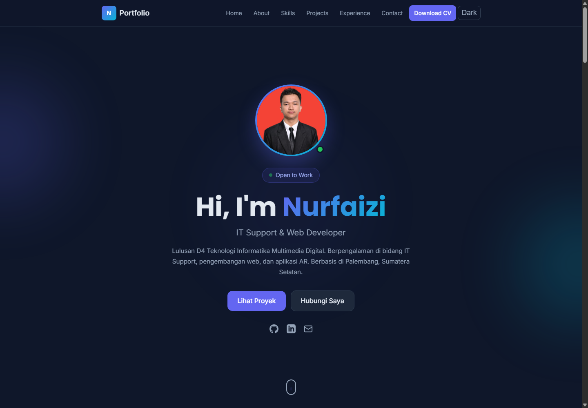
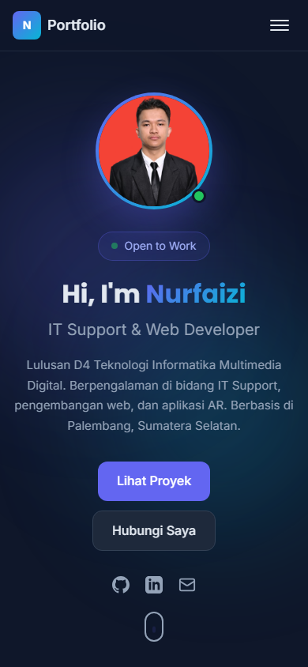
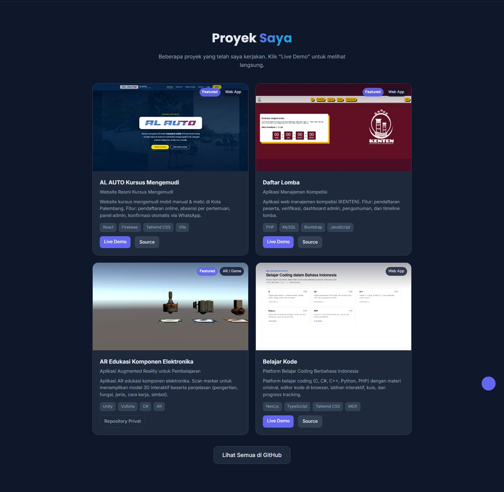

# Portfolio Nurfaizi - IT Support & Web Developer

[](https://developer.mozilla.org/en-US/docs/Web/HTML)
[](https://developer.mozilla.org/en-US/docs/Web/CSS)
[](https://developer.mozilla.org/en-US/docs/Web/JavaScript)
[](https://nurfaizi8879.github.io/portofolio_faizi/)

Website portfolio pribadi yang menampilkan profil, skills, pengalaman, pendidikan, pencapaian, dan proyek-proyek yang telah dikerjakan. Dibangun dengan HTML, CSS, dan JavaScript murni (tanpa framework) untuk performa maksimal dan loading yang cepat.

---

## Live Demo

**URL:** https://nurfaizi8879.github.io/portofolio_faizi/

### Screenshot

| Desktop | Mobile |
|---------|--------|
|  |  |

### Section Projects



---

## Latar Belakang

Portfolio ini dibuat sebagai media presentasi profesional untuk melamar kerja di bidang IT Support dan Web Development. Website ini dirancang untuk:

- Menampilkan profil secara profesional dan menarik.
- Menyajikan skills dengan progress bar yang jelas.
- Menampilkan proyek dengan link live demo dan source code.
- Memudahkan recruiter untuk menilai kemampuan dalam 30-60 detik.
- Responsive di semua device (mobile, tablet, desktop).

---

## Fitur Utama

- **Hero Section** - Foto profil profesional, nama, title, tagline, CTA buttons, social links, scroll indicator.
- **About Me** - Deskripsi diri, highlights (IT Support, Web Dev, AR/Game, Prestasi), tags (lokasi, pendidikan, status).
- **Skills & Tech Stack** - 5 kategori (Web Dev, Backend & DB, AR/Game Dev, IT & Security, Soft Skills) dengan progress bar animasi.
- **Experience** - Timeline pengalaman kerja (Magang LLDIKTI, Full-Stack Developer Lomba Inovasi).
- **Education** - Riwayat pendidikan (D4 Politeknik Negeri Sriwijaya, SMA) + pelatihan (Vinix7).
- **Achievements** - Juara Harapan 1 Lomba Inovasi Kota Palembang 2024.
- **Projects** - 4 proyek dengan thumbnail screenshot, tech badges, Live Demo & Source links.
- **Contact** - Info kontak (email, WhatsApp, lokasi) + form pesan.
- **Dark/Light Mode** - Toggle tema.
- **Responsive** - Mobile-first, tested di 360px, 768px, 1024px, 1440px.
- **Performa** - Vanilla HTML/CSS/JS, tanpa framework, loading cepat.

---

## Tech Stack

| Teknologi | Fungsi |
|-----------|--------|
| HTML5 | Struktur halaman |
| CSS3 | Styling (dark theme, responsive, animations) |
| JavaScript (Vanilla) | Interaktivitas (theme, scroll, form) |
| Google Fonts | Inter (body) + Poppins (heading) |
| GitHub Pages | Hosting & deployment |

---

## Struktur Folder

```
portofolio_faizi/
 index.html              # Halaman utama (single page)
 css/
    style.css           # Stylesheet (design system + responsive)
 js/
    script.js           # JavaScript (theme, scroll, form, animations)
 assets/
    foto-profil.png     # Foto profil di hero section
    icons/              # Favicon
    images/             # Open Graph image + screenshot proyek
       projects/        # Thumbnail tiap proyek
 docs/                   # GitHub Pages deployment copy
    screenshots/        # Screenshot untuk README
 .gitignore
 README.md
```

---

## Instalasi & Cara Menjalankan

### Prasyarat
- Browser modern (Chrome, Firefox, Edge, Safari)
- Text editor (VS Code, Notepad++, dll.)

### Langkah-langkah

```bash
# 1. Clone repository
git clone https://github.com/NURFAIZI8879/portofolio_faizi.git
cd portofolio_faizi

# 2. Buka di browser
# Buka index.html di browser, atau gunakan live server
# VS Code: klik kanan index.html -> "Open with Live Server"

# 3. Edit konten
# Buka index.html dan css/style.css di text editor
# Ubah teks, foto, link sesuai kebutuhan
```

### Deploy ke GitHub Pages

1. Push ke GitHub (branch main)
2. Settings -> Pages -> Source: main branch, `/docs`
3. Website otomatis live di https://nurfaizi8879.github.io/portofolio_faizi/

---

## Data Saya

### Profil
- Nama: Nurfaizi
- Email: faiziasyi140406@gmail.com
- WhatsApp: +62 852-6804-2056
- Lokasi: Palembang, Sumatera Selatan
- GitHub: https://github.com/NURFAIZI8879
- LinkedIn: https://www.linkedin.com/in/nur-faizi-1526782a4/

### Pendidikan
- D4 Teknologi Informatika Multimedia Digital - Politeknik Negeri Sriwijaya (2022-2026, IPK 3.49)
- SMA Negeri 1 Banding Agung - MIPA (2019-2022)

### Pengalaman
- Magang - LLDIKTI Wilayah II, Tim HKT (Februari-Juli 2025)
- Full-Stack Developer - Lomba Inovasi Kota Palembang (2024, Juara Harapan 1)

### Skills
- IT Support: IT Support & Troubleshooting, Cyber Security, Network Security, Computer Hardware Maintenance
- Web Development: HTML, CSS, JavaScript, React, Tailwind CSS, PHP, MySQL, Firebase
- AR/Game Dev: Unity, Vuforia, C#, TextMeshPro
- Soft Skills: Problem Solving, Analytical Thinking, Teamwork, Time Management, Adaptability

### Pencapaian
- Juara Harapan 1 Lomba Inovasi Kota Palembang 2024 (Kategori Masyarakat Tematik)

---

## Peran & Kontribusi

- Peran: Full-Stack Developer (solo)
- Kontribusi:
  - Desain dan pengembangan website portfolio dari awal.
  - Implementasi dark/light mode toggle.
  - Animasi scroll reveal, hover effects, smooth scrolling.
  - Penyusunan konten proyek dan tautan demo/source.
  - Responsive design (mobile-first).
  - Deployment ke GitHub Pages.

---

## Rencana Pengembangan

- [x] Tambah foto profesional di hero section
- [x] Section Experience & Education (timeline)
- [x] Responsive mobile-first (360px - 1440px)
- [x] Meta tags & Open Graph image
- [x] Thumbnail screenshot proyek di section Projects
- [ ] Upload CV PDF (tombol Download CV)
- [ ] Tambah section Testimonial
- [ ] Integrasi blog/artikel
- [ ] Setup custom domain (faizi.dev)
- [ ] Lighthouse score 90+

---

## Kontak

- Email: faiziasyi140406@gmail.com
- WhatsApp: +62 852-6804-2056
- GitHub: https://github.com/NURFAIZI8879
- LinkedIn: https://www.linkedin.com/in/nur-faizi-1526782a4/
- Lokasi: Palembang, Sumatera Selatan

---

## Lisensi

Proyek ini untuk keperluan portofolio pribadi.

---

Catatan untuk recruiter: Portfolio ini menunjukkan kemampuan dalam pengembangan web (HTML/CSS/JS), desain responsive, dan deployment. Semua proyek yang ditampilkan adalah project nyata yang telah dikerjakan, termasuk aplikasi AR (Unity + Vuforia) untuk skripsi dan website kursus mengemudi.
